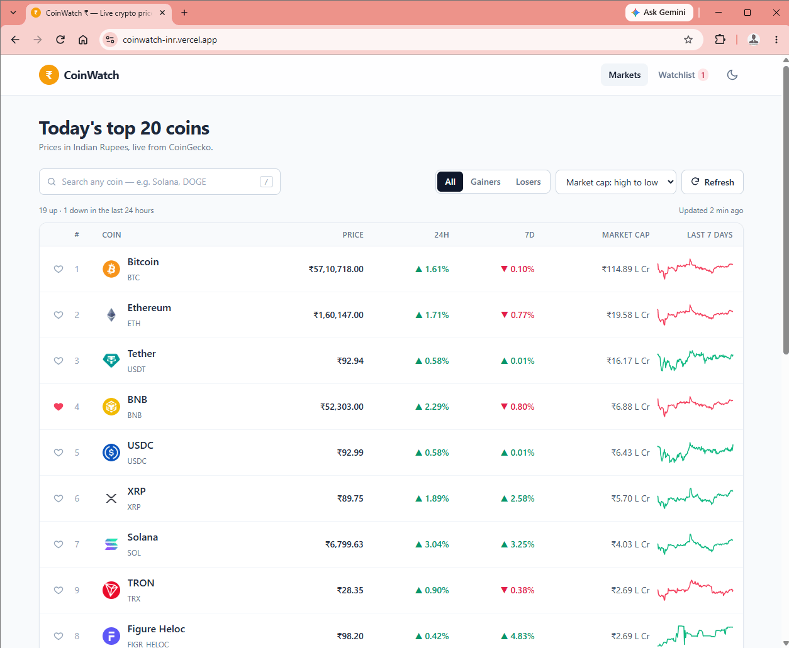
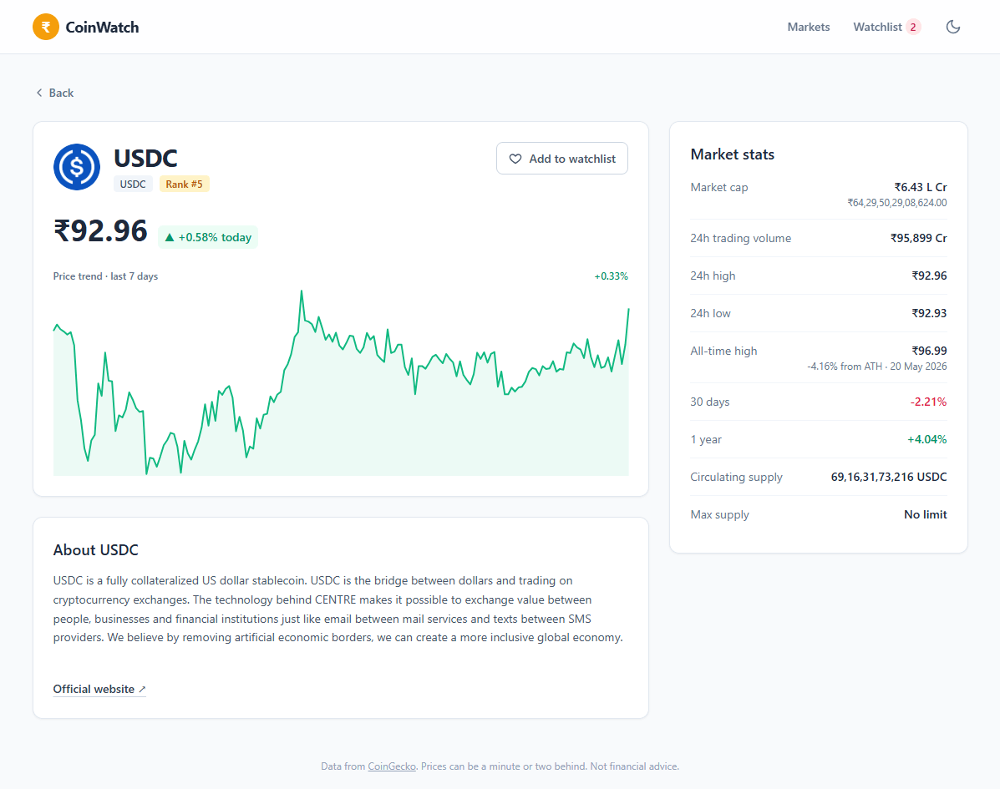
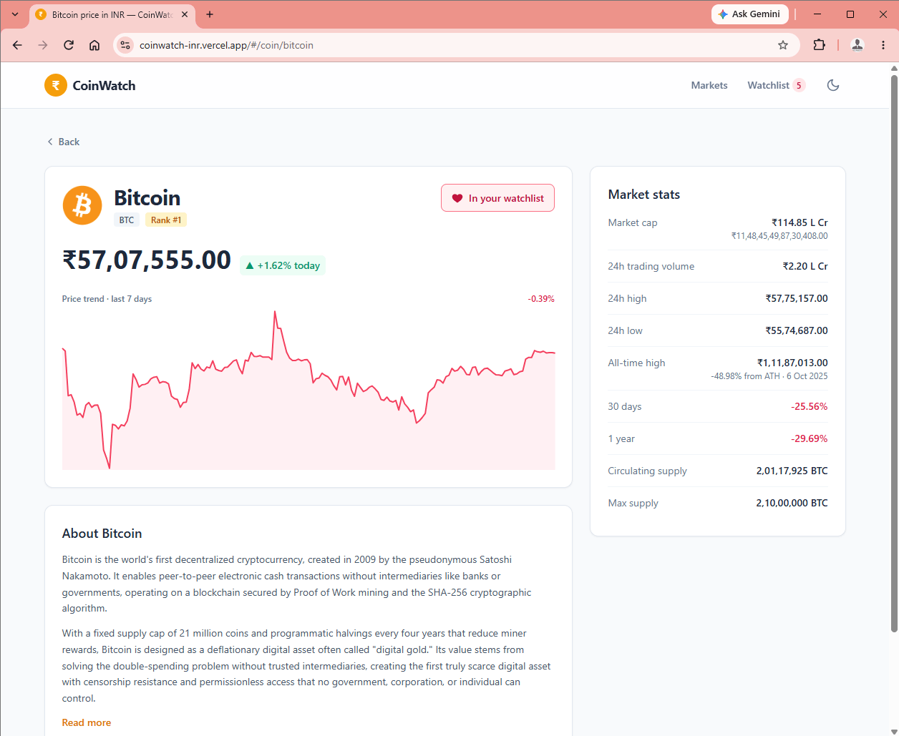
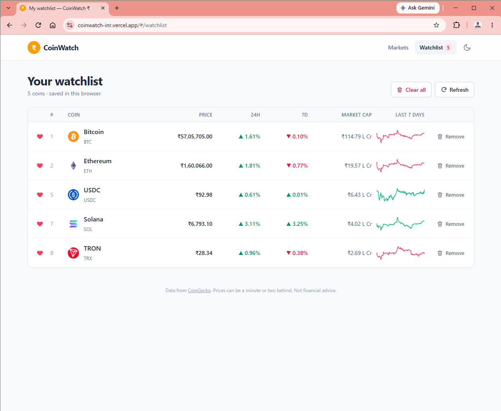

# CoinWatch ₹

A live cryptocurrency price tracker that shows everything in **Indian Rupees**. Browse the top 20 coins, search for any coin, sort and filter the list, heart the coins you care about, and open any coin to read about it.

Built with plain **HTML, Tailwind CSS and vanilla JavaScript**. No frameworks, no libraries, no build step.

**Live demo:** _add your Vercel link here_

> Milestone 2 Project — JavaScript Mastery · Option A: Market Tracker

---

## Features

- **Top 20 coins** by market cap, with price, 24h change, 7d change, market cap and a 7-day mini chart
- **Green / red price logic** with ▲ ▼ arrows, so the direction is clear even without colour
- **Search any coin** by name or symbol. Debounced, so it doesn't call the API on every keystroke
- **Sort** by market cap, price or 24h change; **filter** to gainers or losers only
- **Refresh button** that re-fetches prices without reloading the page, plus an "Updated 2 min ago" label
- **Watchlist**: tap the ♡ on any coin and it's saved to LocalStorage. It survives a refresh
- **Remove from the watchlist**: a Remove button on every watchlist row, a Clear all button, or just tap the heart again. Storage updates straight away, and every removal can be undone
- The Watchlist link is always in the menu, with a badge showing how many coins you've saved
- **Coin detail page**: description, 7-day price chart, all-time high, supply and more
- **Indian number format**: `₹56,04,012`, with big numbers shown as `₹11.27 L Cr`
- **Loading, error and empty states** on every screen. Skeleton loaders while data loads, a clear error with "Try again", and friendly "nothing found" messages
- **Dark mode**, remembered between visits
- **Responsive**: full table on desktop, compact list on phones
- Keyboard friendly: press `/` to search and `Esc` to clear

## API used

[CoinGecko API](https://docs.coingecko.com/) (free, no API key)

| Purpose | Endpoint |
|---|---|
| Top 20 coins | `GET /coins/markets?vs_currency=inr&per_page=20&sparkline=true` |
| Search | `GET /search?query={text}` |
| Prices for search results / watchlist | `GET /coins/markets?vs_currency=inr&ids={id1,id2}` |
| Coin detail | `GET /coins/{id}` |

The free plan allows about 30 requests per minute. If that limit is hit, the app shows a clear message asking you to wait a minute.

## How the code is organised

```
index.html       page layout: header, the three screens, footer
style.css        table grid, skeleton shimmer, buttons (things easier in plain CSS)
js/utils.js      ₹ formatting, percent, time-ago, debounce
js/storage.js    LocalStorage: watchlist and theme
js/api.js        every CoinGecko call, using fetch + async/await
js/render.js     builds rows, cards, charts and messages with DOM methods
js/app.js        state, event listeners, hash router (#/, #/coin/:id, #/watchlist)
```

The scripts load in that order with `defer`, so each file can use functions from the ones before it.

### A few things worth pointing out

- **Event delegation:** each coin list has a single click listener on its container (`handleListClick` in `app.js`). It works out whether the heart, the Remove button or the row was clicked using `event.target.closest()`. Rows are rebuilt on every sort, filter and refresh, so this avoids re-adding 20 listeners each time.
- **Out-of-order responses:** each search gets an id (`latestSearchId`). When a response comes back, it's only drawn if its id is still the latest. Typing "bit" then "bitc" quickly can never end with the "bit" results on screen.
- **Error handling:** `getJSON()` in `api.js` turns network failures, 404s and 429 rate limits into readable messages. Every screen calls the API inside `try/catch` and shows the error state with a retry button.
- **Array methods:** `map` builds rows and pulls ids, `filter` handles gainers/losers and removing from the watchlist, `sort` drives the sort dropdown, `find` puts search results back into best-match order.

## Running it locally

No install needed.

1. Download or clone the repo
2. Open `index.html` in a browser, or use the VS Code **Live Server** extension

An internet connection is needed for the prices and for the Tailwind CDN.

## Tech stack

| Part | Used |
|---|---|
| Markup | HTML5 |
| Styling | Tailwind CSS (Play CDN) + a small `style.css` |
| Logic | Vanilla JavaScript (ES2020+), no frameworks or libraries |
| Charts | Hand-drawn inline SVG |
| Data | CoinGecko public API (no key) |
| Storage | Browser LocalStorage |
| Hosting | Vercel (static site, no build step) |

## How it meets the Milestone 2 brief

| Requirement | Where it's done |
|---|---|
| Vanilla JS only, no frameworks / jQuery | Whole project |
| Results built with DOM methods | `render.js` uses `createElement`, `textContent`, `append`, `replaceChildren` |
| `map` / `filter` / `sort` / `find` | `getVisibleCoins()`, `searchCoins()`, `renderCoinList()`, `toggleWatchlist()` |
| Event delegation | `handleListClick()` in `app.js`: one listener per list handles hearts, Remove buttons and row clicks |
| `fetch` with `async/await`, no `.then()` | `api.js` |
| `try/catch` on every API call | `getJSON()` plus every loader in `app.js` (`loadTopCoins`, `runSearch`, `loadWatchlist`, `loadCoinDetail`) |
| Loading, error and empty states | Skeleton rows, red error box with Try again, "No coins match…" / "Your watchlist is empty" |
| User-triggered fetch | Search box and Refresh button |
| LocalStorage that survives refresh, and remove syncs storage | `storage.js`; Remove, Clear all and Undo update storage immediately |
| Responsive, hover/active states | Table on desktop, compact rows on phones; hover and press styles on every button and row |
| Stretch goals | Debounced search ✅ Dark mode ✅ Skeleton loaders ✅ |

## Known limitations

- CoinGecko's free plan allows about 30 requests a minute, so very fast repeated refreshing can show the "Too many requests" message for a minute.
- The watchlist is saved per browser and per address, so it doesn't sync between devices, and the local file and the live site keep separate lists.
- Prices can be a minute or two behind the exchanges, because the free API is cached.

## Screenshots






## What I'd add next

- Price alerts when a coin crosses a set price
- Switching currency between ₹ and $
- A longer price chart (30 days / 1 year)

